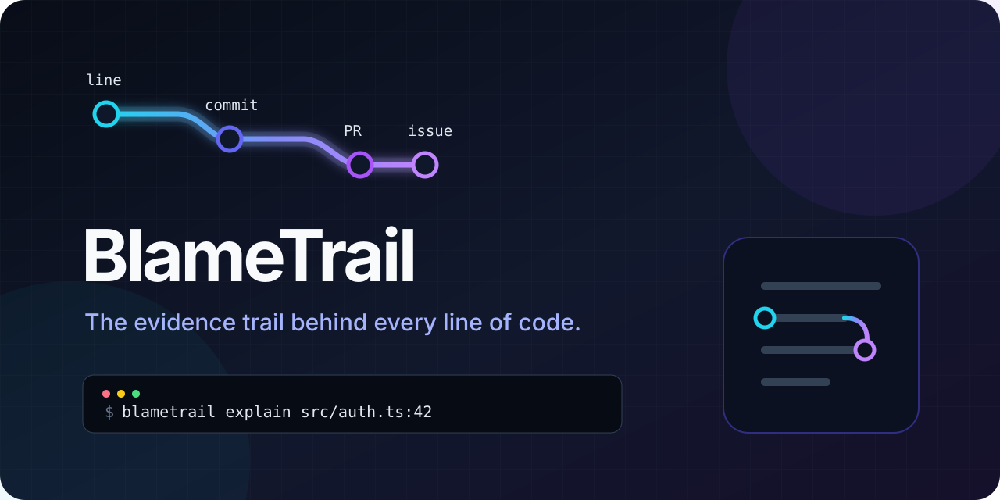

<div align="center">
  
</div>

<div align="center">

[](https://github.com/liyuan-chuchu/blametrail/actions/workflows/ci.yml)
[](LICENSE)
[](https://nodejs.org)
[](package.json)

[English](README.md) · **简体中文** · [路线图](docs/ROADMAP.md) · [参与贡献](CONTRIBUTING.md)

</div>

BlameTrail 是一个本地优先的代码考古 CLI 与 GitHub Action。输入一行代码或一个 Pull Request，它会沿着 **提交 → PR → issue → review → revert** 追溯，并链接到原始证据。

```console
$ blametrail explain src/auth/session.ts:42

BlameTrail — evidence for src/auth/session.ts:42-42
Repository: acme/app

Commits
- [regression] [bug-fix] a31c92 Fix session race during token refresh

Pull requests
- [regression] [bug-fix] #812 Prevent duplicate refresh requests

Linked issues
- [bug-fix] #744 Intermittent logout under concurrent requests
```

> BlameTrail 不会断言历史决策一定正确。它的作用是在维护者或编码 Agent 简化、重构、重写代码之前，把原始上下文和可验证证据找回来。

## 快速开始

需要 Node.js 20+ 与 Git。

```bash
# 直接从 GitHub 运行
npx github:liyuan-chuchu/blametrail explain src/auth.ts:42

# 或全局安装
npm install --global github:liyuan-chuchu/blametrail
blametrail explain src/auth.ts:42-60
```

检查一个 PR 是否触碰了历史上的修复、回滚或兼容性约束：

```bash
blametrail review 128
blametrail review https://github.com/acme/app/pull/128 --markdown
```

完全离线运行，或给编辑器/Agent 输出 JSON：

```bash
blametrail explain src/auth.ts:42 --offline
blametrail explain src/auth.ts:42 --json
```

## 和 `git blame` 有什么不同？

| 问题 | `git blame` | BlameTrail |
| --- | :---: | :---: |
| 谁最后修改了这一行？ | ✓ | ✓ |
| 哪个提交引入了它？ | ✓ | ✓ |
| 哪个 PR、issue 和 review 解释了原因？ | — | ✓ |
| 它是否源于修复、回滚、变通方案或兼容约束？ | — | ✓ |
| 当前 PR 是否再次触碰历史雷区？ | — | ✓ |
| 编码 Agent 能否直接读取结构化证据？ | — | ✓ |

`security`、`regression`、`compatibility`、`workaround` 等标签采用透明的关键词规则，只是提醒维护者进一步查看的**线索**，不是自动化漏洞或正确性结论。

## GitHub Action

为每个 PR 生成只读的历史上下文摘要：

```yaml
name: Historical context

on:
  pull_request:

permissions:
  contents: read
  pull-requests: read
  issues: read

jobs:
  blametrail:
    runs-on: ubuntu-latest
    steps:
      - uses: actions/checkout@v4
        with:
          fetch-depth: 0
      - uses: liyuan-chuchu/blametrail@v0.1.0
        with:
          github_token: ${{ secrets.GITHUB_TOKEN }}
```

Action 只写入 Workflow Summary，不会自动发评论、批准 PR、修改文件或申请写权限。

## 隐私与安全

- 默认只读，不会修改被分析仓库。
- 本地分析不会上传源码。
- 远程增强只向 GitHub 请求仓库中已有的提交、PR、review 与 issue 数据。
- 无遥测、无账号、无数据库、无守护进程、无托管服务、无需模型 API。
- 运行时第三方依赖数量：**0**。
- Token 只通过 `GITHUB_TOKEN` 或 `GH_TOKEN` 环境变量读取，不接受命令行传参。

## 当前限制

- 远程证据目前支持 GitHub.com；本地 Git 分析适用于任何托管平台。
- Squash merge 或重写历史可能使 commit 与 PR 的关联不完整。
- PR 审查依赖完整的本地历史，浅克隆只能给出部分证据。
- 风险标签重视透明、可解释，因此不会覆盖所有语义情况。

## 从源码构建

```bash
git clone https://github.com/liyuan-chuchu/blametrail.git
cd blametrail
npm ci
npm test
npm link
```

CI 会在 Windows、macOS、Linux 上测试 Node 20、22、24。架构与信任边界见 [docs/ARCHITECTURE.md](docs/ARCHITECTURE.md)，计划见 [docs/ROADMAP.md](docs/ROADMAP.md)。

## 参与贡献

欢迎 issue 和 PR。适合作为第一项贡献的方向包括：公开仓库证据样例、GitLab 支持、更准确的 revert 配对、编辑器集成和文档改进。请先阅读 [CONTRIBUTING.md](CONTRIBUTING.md) 与 [AGENTS.md](AGENTS.md)。

如果 BlameTrail 帮你避免误删一次生产修复，欢迎给项目一个 Star，让更多维护者看到它。

## 许可

Apache-2.0 © 2026 [liyuan-chuchu](https://github.com/liyuan-chuchu)。
